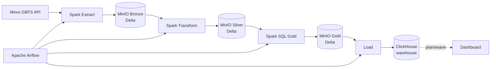

# Mevo Bikes Lakehouse

**Lokalny lakehouse dla danych o rowerach miejskich Mevo (Trójmiasto)**, zbudowany na Apache Spark, Delta Lake, MinIO, Airflow i ClickHouse.

`Apache Airflow · PySpark · Delta Lake · MinIO · ClickHouse · Docker · Spark SQL`

Projekt co 30 minut pobiera dane o stacjach i rowerach z publicznego API GBFS systemu Mevo, zapisuje je w data lake (MinIO) jako tabele Delta w architekturze medallion (Bronze → Silver → Gold), a gotową warstwę Gold ładuje do hurtowni ClickHouse. Całość jest orkiestrowana przez Apache Airflow i uruchamiana lokalnie w Docker Compose.

[English version ↓](#english-version)

## Spis treści

- [Funkcje](#funkcje)
- [Architektura](#architektura)
- [Warstwy danych](#warstwy-danych)
- [Model danych](#model-danych)
- [Orkiestracja w Airflow](#orkiestracja-w-airflow)
- [Stack technologiczny](#stack-technologiczny)
- [Źródło danych](#źródło-danych)
- [Struktura projektu](#struktura-projektu)
- [Szybki start](#szybki-start)
- [Walidacja pipeline'u](#walidacja-pipelineu)
- [Decyzje projektowe](#decyzje-projektowe)
- [Autor i kontakt](#autor-i-kontakt)

## Funkcje

- **Konteneryzowane środowisko** - cały stack uruchamiany przez Docker Compose
- **Orkiestracja ETL** - DAG Airflow wykonujący pipeline co 30 minut
- **Lakehouse na Delta Lake** - Bronze, Silver i Gold jako tabele Delta w MinIO (protokół S3A)
- **Odporne pobieranie danych** - ponawianie zapytań do API z exponential backoff
- **Przetwarzanie przyrostowe** - Silver czyta z Bronze tylko nowe snapshoty i zapisuje je przez `MERGE`
- **Kontrola jakości danych** - flagi jakości w Silver (współrzędne poza obszarem usługi, ujemne liczniki)
- **Star schema w Gold** - wymiary stacji, typów rowerów i daty oraz fakt stanu stacji
- **Agregaty analityczne** - godzinowe obłożenie stacji
- **Hurtownia ClickHouse** - Gold ładowany do tabel `MergeTree` jako warstwa serwowania danych
- **Eksploracja danych** - notebook Jupyter z EDA wszystkich feedów GBFS
- **Trwałe wolumeny** - osobne wolumeny dla MinIO, ClickHouse i metadanych Airflow

## Architektura



| Komponent | Rola |
| --- | --- |
| **Apache Airflow** | Harmonogram, zależności i monitoring zadań |
| **Apache Spark** | Ekstrakcja, transformacje Silver, budowa Gold |
| **Delta Lake** | Format tabel w MinIO: transakcje, `MERGE`, time travel |
| **MinIO** | Lokalny storage zgodny z S3 dla warstw Bronze, Silver i Gold |
| **ClickHouse** | Hurtownia danych: szybka warstwa serwowania Gold |
| **Redis** | Broker komunikatów dla CeleryExecutor |
| **Jupyter** | Eksploracyjna analiza danych |

Lakehouse jest źródłem prawdy: cała logika transformacji siedzi w Sparku, a ClickHouse tylko udostępnia gotowy Gold do szybkich zapytań. Hurtownię można w każdej chwili odbudować z bucketa.

## Warstwy danych

Wszystkie warstwy leżą w bucketcie `lakehouse` w MinIO.

### Bronze - `s3a://lakehouse/bronze/mevo/`

Rekordy z API zapisane bez zmian, z dodaną kolumną `last_updated` (czas wygenerowania zrzutu przez API).

- `station_status`, `free_bike_status` - snapshoty, tryb `append`, partycje `year/month`. Zostaje wszystko, co zwróciło API, a deduplikacja należy do Silvera.
- `vehicle_types`, `system_pricing_plans`, `station_information` - rzadko się zmieniają, więc tryb `overwrite` bez partycji (poprzednie wersje dostępne przez time travel).

### Silver - `s3a://lakehouse/silver/mevo/`

Oczyszczone, otypowane i znormalizowane dane.

- `station_status` - pełna historia snapshotów (klucz `station_id` + `last_updated`), spłaszczone `vehicle_types_available` do `bikes_available` i `ebikes_available`, flaga `has_negative_counts`.
- `free_bike_status` - historia zmian stanu rowerów (klucz `bike_id` + `last_reported`), flaga `has_invalid_coordinates`, usunięte `rental_uris`.
- `station_information`, `vehicle_types`, `system_pricing_plans` - wymiary nadpisywane przy każdym uruchomieniu.

Tabele zdarzeń są aktualizowane przyrostowo: filtr po `last_updated` ogranicza odczyt z Bronze, a `MERGE ... WHEN NOT MATCHED THEN INSERT` pomija rekordy z kluczem, który już istnieje.

### Gold - `s3a://lakehouse/gold/mevo/`

Zdenormalizowana star schema i agregaty, budowane zapytaniami Spark SQL z `src/SQL/gold/`. Gold jest w całości przeliczany z Silvera (`overwrite`).

### ClickHouse - baza `warehouse`

Kopia tabel Gold w silniku `MergeTree`, z partycjami miesięcznymi dla faktu i agregatu. Tabele tworzy `src/SQL/clickhouse/00_create_tables.sql`, a `load.py` przed każdym ładowaniem robi `TRUNCATE`.

## Model danych

### Wymiary

| Tabela | Opis |
| --- | --- |
| `dim_station` | stacje: nazwa, adres, współrzędne, `capacity`, flaga stacji wirtualnej |
| `dim_vehicle_type` | typy rowerów połączone z cennikiem (`bike`, `ebike`) |
| `dim_date` | kalendarz: rok, kwartał, miesiąc, dzień tygodnia, `is_weekend` |

### Fakt

`fact_station_status` - ziarno: jedna stacja w jednym snapshocie. Zawiera liczbę rowerów (zwykłych i elektrycznych), wolne doki, `occupancy_ratio`, flagi `is_empty` i `is_full` oraz status stacji. `date_key` i `hour` liczone są w strefie `Europe/Warsaw`, a pełny czas zapisany także w UTC. Snapshoty z ujemnymi licznikami są odrzucane.

### Agregat

`station_hourly_occupancy` - per stacja, dzień i godzina: średnia, minimum i maksimum rowerów, średnia liczba e-rowerów i wolnych doków, średnie obłożenie oraz odsetek czasu, gdy stacja była pusta albo pełna. Uwzględnia tylko stacje z `is_installed`.

## Orkiestracja w Airflow

DAG `mevo_lakehouse` działa co 30 minut (`max_active_runs=1`, 3 ponowienia zadań co 2 minuty):

```
ensure_bucket → extract_bronze → transform_silver → build_gold → load_clickhouse
```

| Zadanie | Działanie |
| --- | --- |
| `ensure_bucket` | tworzy bucket `lakehouse` w MinIO, jeśli go nie ma |
| `extract_bronze` | `extract.py`: API → Bronze |
| `transform_silver` | `transform.py`: Bronze → Silver |
| `build_gold` | `gold.py`: Silver → Gold |
| `load_clickhouse` | `load.py`: Gold → ClickHouse |

Zadania Spark Airflow uruchamia przez `docker exec ... spark-submit` w kontenerze `mevo-bikes-spark` (worker ma dostęp do `docker.sock`).

## Stack technologiczny

| Kategoria | Technologie |
| --- | --- |
| Orkiestracja | Apache Airflow 3 (CeleryExecutor), Redis |
| Przetwarzanie | Apache Spark 3.5, PySpark, Spark SQL |
| Format tabel | Delta Lake 3.3 |
| Storage | MinIO (S3A) |
| Hurtownia | ClickHouse 24.8, `clickhouse-connect` |
| Infrastruktura | Docker, Docker Compose |
| Pobieranie danych | `requests` z `urllib3.Retry` |
| Analiza | Jupyter, pandas |

## Źródło danych

[GBFS](https://gbfs.org/) systemu rowerowego Mevo, publikowany przez Urban Sharing: `https://gbfs.urbansharing.com/rowermevo.pl`.

| Feed | Opis | Rekordów |
| --- | --- | --- |
| `vehicle_types` | typy rowerów | ~2 |
| `system_pricing_plans` | cenniki | ~2 |
| `station_information` | stacje | ~865 |
| `station_status` | stan stacji | ~865 na pobranie |
| `free_bike_status` | rowery poza stacjami | ~890 na pobranie |

Dane są publiczne i odświeżane przez API co kilkanaście sekund.

## Struktura projektu

```
mevo-bikes-lakehouse/
├── airflow/
│   └── dags/dag.py              # DAG mevo_lakehouse
├── docker/
│   ├── Dockerfile               # Spark + Delta + S3A
│   └── Dockerfile.airflow       # Airflow + docker CLI
├── notebooks/
│   └── eda.ipynb                # EDA feedów GBFS
├── src/
│   ├── etl/
│   │   ├── extract.py           # API -> Bronze
│   │   ├── transform.py         # Bronze -> Silver
│   │   ├── gold.py              # Silver -> Gold
│   │   └── load.py              # Gold -> ClickHouse
│   └── SQL/
│       ├── gold/
│       │   ├── dimensions/      # dim_station, dim_vehicle_type, dim_date
│       │   ├── facts/           # fact_station_status
│       │   └── aggregates/      # station_hourly_occupancy
│       └── clickhouse/
│           └── 00_create_tables.sql
├── docker-compose.yaml
├── requirements.txt
└── .env.example
```

## Szybki start

### Wymagania

- Docker Desktop z Docker Compose
- ok. 8 GB wolnej pamięci RAM dla całego stacku

### 1. Skonfiguruj środowisko

```powershell
Copy-Item .env.example .env
```

W pliku `.env` ustaw dane dostępowe do MinIO i ClickHouse oraz `FERNET_KEY` dla Airflow. Klucz wygenerujesz poleceniem:

```powershell
python -c "from cryptography.fernet import Fernet; print(Fernet.generate_key().decode())"
```

### 2. Uruchom stack

```powershell
docker compose up -d --build
```

### 3. Uruchom pipeline

W Airflow włącz DAG `mevo_lakehouse` (jest domyślnie wstrzymany). Od tej chwili pipeline działa co 30 minut, a pierwszy przebieg możesz wywołać ręcznie przyciskiem *Trigger*.

### Dostępne usługi

| Usługa | Adres |
| --- | --- |
| Airflow | http://localhost:8080 (domyślnie `admin` / `admin`) |
| MinIO Console | http://localhost:9001 |
| ClickHouse HTTP | http://localhost:8123 |
| ClickHouse native | `localhost:9002` |

## Walidacja pipeline'u

Do czasu dodania testów automatycznych walidacja jest ręczna.

Zawartość hurtowni:

```powershell
docker exec mevo-clickhouse clickhouse-client --user clickhouse --password clickhouse -d warehouse -q "SELECT count() FROM fact_station_status"
docker exec mevo-clickhouse clickhouse-client --user clickhouse --password clickhouse -d warehouse -q "SELECT * FROM station_hourly_occupancy ORDER BY avg_occupancy_ratio DESC LIMIT 10"
```

Przykład analizy: stacje, na których najczęściej brakuje rowerów.

```sql
SELECT
    s.station_name,
    round(avg(h.empty_ratio), 3) AS empty_ratio
FROM station_hourly_occupancy AS h
INNER JOIN dim_station AS s ON h.station_id = s.station_id
GROUP BY s.station_name
ORDER BY empty_ratio DESC
LIMIT 10
```

Dodatkowo: statusy zadań w Airflow, obiekty w MinIO (`bronze`, `silver`, `gold`) oraz historia wersji tabel Delta (`DESCRIBE HISTORY`).

## Decyzje projektowe

- **Bronze trzyma wszystko.** Nie filtruję pojedynczych rekordów przy pobieraniu: usuwanie duplikatów to zadanie Silvera, dzięki czemu Silver można przeliczyć od nowa.
- **`last_updated` obok `last_reported`.** `last_updated` opisuje moment snapshotu i służy do przetwarzania przyrostowego oraz analiz w czasie. W danych Mevo `last_reported` stacji pokrywa się z czasem zrzutu.
- **Silver znormalizowany, Gold zdenormalizowany.** Wymiary i fakty są osobno w Silverze, a Gold to star schema pod zapytania analityczne.
- **Statyczne feedy bez partycji.** Dwuwierszowe tabele nie zyskują na partycjach, a `overwrite` zapobiega narastaniu identycznych rekordów.
- **ClickHouse jako warstwa serwowania.** Logika zostaje w lakehousie. ClickHouse jest kolumnowy i szybki na agregatach szeregów czasowych, a Gold ładuję do niego sterownikiem `clickhouse-connect`, żeby mieć pełną kontrolę nad typami.
- **Docker Compose zamiast Kubernetesa.** Skala projektu tego nie wymaga.

## O projekcie

Mevo Bikes Lakehouse to praktyczny projekt data engineeringowy. Pokazuje kompletny, lokalny pipeline: pobieranie danych z API, lakehouse w architekturze medallion na Delta Lake, orkiestrację, modelowanie wymiarowe i hurtownię analityczną.

## Autor i kontakt

| | |
| --- | --- |
| **Autor** | Maciej Spychalski ([Turbo-Blender](https://github.com/Turbo-Blender)) |
| **Email** | [m.spychalskipv@gmail.com](mailto:m.spychalskipv@gmail.com) |
| **Repozytorium** | [github.com/Turbo-Blender/mevo-bikes-lakehouse](https://github.com/Turbo-Blender/mevo-bikes-lakehouse) |

---

<a id="english-version"></a>

# Mevo Bikes Lakehouse (English)

**A local lakehouse for Mevo city bike data (Tricity, Poland)**, built with Apache Spark, Delta Lake, MinIO, Airflow, and ClickHouse.

`Apache Airflow · PySpark · Delta Lake · MinIO · ClickHouse · Docker · Spark SQL`

Every 30 minutes the pipeline pulls station and bike data from Mevo's public GBFS API, stores it in a data lake (MinIO) as Delta tables using the medallion architecture (Bronze → Silver → Gold), and loads the Gold layer into a ClickHouse data warehouse. Everything is orchestrated by Apache Airflow and runs locally with Docker Compose.

## Implemented features

- **Containerized environment** - the whole stack runs through Docker Compose
- **ETL orchestration** - an Airflow DAG running every 30 minutes
- **Delta Lake lakehouse** - Bronze, Silver, and Gold as Delta tables in MinIO (S3A)
- **Resilient ingestion** - API requests retried with exponential backoff
- **Incremental processing** - Silver reads only new snapshots from Bronze and writes them with `MERGE`
- **Data quality flags** - out-of-area coordinates and negative counters flagged in Silver
- **Gold star schema** - station, vehicle type, and date dimensions plus a station status fact
- **Analytical aggregate** - hourly station occupancy
- **ClickHouse warehouse** - Gold loaded into `MergeTree` tables as the serving layer
- **Exploratory analysis** - Jupyter notebook covering all GBFS feeds

## Architecture

```
Mevo GBFS API -> Spark Extract -> Bronze (Delta, MinIO)
              -> Spark Transform -> Silver (Delta, MinIO)
              -> Spark SQL -> Gold (Delta, MinIO)
              -> Load -> ClickHouse
Airflow orchestrates all four Spark jobs.
```

The lakehouse is the source of truth: all transformation logic lives in Spark, and ClickHouse only serves the finished Gold tables. The warehouse can be rebuilt from the bucket at any time.

## Data layers

| Layer | Location | Contents |
| --- | --- | --- |
| Bronze | `s3a://lakehouse/bronze/mevo/` | API records as returned, plus `last_updated`. Snapshots (`station_status`, `free_bike_status`) are appended and partitioned by `year/month`; static feeds are overwritten without partitions |
| Silver | `s3a://lakehouse/silver/mevo/` | Typed, deduplicated, normalized data with quality flags. Event tables are updated incrementally via `MERGE`; dimensions are overwritten |
| Gold | `s3a://lakehouse/gold/mevo/` | Star schema and aggregates built with Spark SQL from `src/SQL/gold/` |
| ClickHouse | database `warehouse` | `MergeTree` copy of Gold, monthly partitions for the fact and the aggregate |

## Data model

| Table | Type | Description |
| --- | --- | --- |
| `dim_station` | dimension | stations: name, address, coordinates, capacity |
| `dim_vehicle_type` | dimension | bike types joined with pricing plans |
| `dim_date` | dimension | calendar with `is_weekend` |
| `fact_station_status` | fact | one station in one snapshot: bikes, e-bikes, free docks, `occupancy_ratio`, `is_empty`, `is_full` |
| `station_hourly_occupancy` | aggregate | per station, day, and hour: average/min/max bikes, share of time empty or full |

`date_key` and `hour` are computed in the `Europe/Warsaw` time zone; the UTC timestamp is stored as well.

## Airflow DAG

`mevo_lakehouse` runs every 30 minutes (`max_active_runs=1`, 3 task retries):

```
ensure_bucket -> extract_bronze -> transform_silver -> build_gold -> load_clickhouse
```

Spark jobs are started via `docker exec ... spark-submit` in the `mevo-bikes-spark` container.

## Quick start

```powershell
Copy-Item .env.example .env        # set credentials and FERNET_KEY
docker compose up -d --build       # full stack
```

Then enable the `mevo_lakehouse` DAG in Airflow (http://localhost:8080). It is paused by default; once enabled it runs every 30 minutes, and you can trigger the first run manually.

| Service | URL |
| --- | --- |
| Airflow | http://localhost:8080 |
| MinIO Console | http://localhost:9001 |
| ClickHouse HTTP | http://localhost:8123 |

## Design decisions

- **Bronze keeps everything.** Record-level deduplication belongs to Silver, so Silver can always be rebuilt.
- **Silver normalized, Gold denormalized.** Dimensions and facts stay separate in Silver; Gold is a star schema built for analytical queries.
- **Static feeds are not partitioned.** Two-row tables gain nothing from partitions, and `overwrite` avoids piling up identical records.
- **ClickHouse as the serving layer.** Logic stays in the lakehouse; Gold is loaded with `clickhouse-connect` for full control over types.
- **Docker Compose over Kubernetes.** The project's scale does not call for it.

## Data source

Mevo's [GBFS](https://gbfs.org/) feeds published by Urban Sharing: `https://gbfs.urbansharing.com/rowermevo.pl`.

## Author & contact

| | |
| --- | --- |
| **Author** | Maciej Spychalski ([Turbo-Blender](https://github.com/Turbo-Blender)) |
| **Email** | [m.spychalskipv@gmail.com](mailto:m.spychalskipv@gmail.com) |
| **Repository** | [github.com/Turbo-Blender/mevo-bikes-lakehouse](https://github.com/Turbo-Blender/mevo-bikes-lakehouse) |
